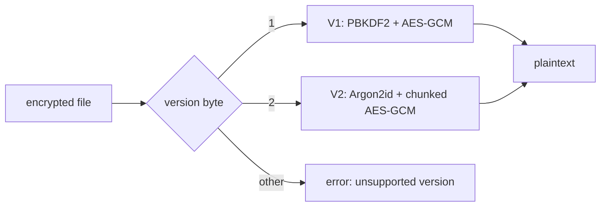

<div align="center">

# 🔐 Casemate

**Future-proof file encryption for the command line.**
Versioned formats, so files you encrypt today still open after the algorithms change.

[](https://github.com/dterana/casemate/actions/workflows/ci.yml)
[](https://github.com/dterana/casemate/releases)
[](go.mod)
[](LICENSE)
[](#limitations)
[](#compatibility)
[](#compatibility)

[](#security-features)
[](#security-features)
[](#file-format)
[](#security-features)
[](https://github.com/dterana/homebrew-tap)
[](go.mod)
[](#development)

</div>

---

> **Formerly Bitseal.** The project was renamed to Casemate in v0.4.0 to avoid confusion with an unrelated product called BitSeal. The file format is unchanged: files encrypted with Bitseal v0.1.0 to v0.3.1 decrypt with Casemate.

## Table of contents

- [Quick start](#quick-start)
- [Why Casemate](#why-casemate)
- [Alternatives](#alternatives)
- [Compatibility](#compatibility)
- [Installation](#installation)
- [Usage](#usage)
- [How it works](#how-it-works)
- [Architecture](#architecture)
- [Security considerations](#security-considerations)
- [Limitations](#limitations)
- [Examples](#examples)
- [Troubleshooting](#troubleshooting)
- [Development](#development)
- [Issues and pull requests](#issues-and-pull-requests) and [License](#license)

## Quick start

```bash
go install github.com/dterana/casemate/cmd/casemate@latest

casemate encrypt notes.txt            # asks for a password twice, writes notes.txt.enc
casemate decrypt notes.txt.enc        # restores notes.txt
casemate info notes.txt.enc           # shows the format, no password needed
```

## Why Casemate

Casemate is a lightweight command-line utility for encrypting and decrypting files with automatic version management. Unlike tools like OpenSSL that change their defaults and break backward compatibility, Casemate embeds version information in every encrypted file, allowing it to decrypt old files even after algorithm changes.

| | |
|---|---|
| 🔒 **Future-proof** | Every file records its format. Decrypt old files forever, even after updating algorithms |
| 🔐 **Secure** | AES-256-GCM, Argon2id key derivation, per-file salts, optional key file, hidden password input |
| 🌊 **Streaming** | Chunked format: large files use bounded memory and can flow through pipes |
| 🧰 **Scriptable** | Password from a file or environment variable, stdin and stdout, clean stdout, real exit codes |
| 🔁 **Upgradable** | `rekey` moves old files to the current format, or changes the password or key file, atomically |
| 🚀 **Extensible** | Interface-based design makes adding new cipher versions trivial |
| 📦 **Minimal** | Go standard library plus `golang.org/x/crypto` and `golang.org/x/term` |

## Alternatives

Casemate covers a narrow job: encrypt a file with a password, optionally combined with a key file, from one static binary. Other tools cover the same ground, and some are the better choice:

| Tool | Choose it when |
|---|---|
| [`age`](https://age-encryption.org) | You want the most widely reviewed small tool for file encryption, or public-key recipients. `age -p` is the closest equivalent to Casemate |
| [`sops`](https://github.com/getsops/sops) | You keep secrets inside a repository and want per-value encryption, diffs and KMS integration |
| `gpg` | You already have a GPG key infrastructure |
| Casemate | You want AES-256-GCM with Argon2id, a password plus a key file as a combined factor, and an on-disk format that stays decryptable across versions |

Casemate has its own file format ([docs/format.md](docs/format.md)) and has not had an independent security audit. For data where that matters, prefer an audited tool.

## Compatibility

### Platforms

| | Linux | macOS |
|---|:---:|:---:|
| Tested in CI | ✅ `ubuntu-latest` | ✅ `macos-latest` |
| Release binaries | amd64, arm64 | amd64, arm64 |
| Homebrew | ✅ | ✅ |
| Build from source | Go 1.26+ | Go 1.26+ |

Windows is not supported for now: no binaries are built and the test suite does not run there.


### File formats

| Version | Written by this build | Decrypt | `rekey` | `info` | Notes |
|:---:|:---:|:---:|:---:|:---:|---|
| 1 | no | ✅ | ✅ (upgrades) | ✅ | Legacy: PBKDF2-SHA256, static salt, single block |
| 2 | ✅ (current) | ✅ | ✅ | ✅ | Argon2id, per-file salt, chunked, optional key file |
| newer | n/a | refused with a clear error | refused | refused | `unsupported encryption version` |



## Installation

### Homebrew (macOS and Linux)
```bash
brew tap dterana/tap
brew trust --tap dterana/tap   # Homebrew 7 only loads third-party taps you have trusted
brew install casemate
```
The formula lives in [dterana/homebrew-tap](https://github.com/dterana/homebrew-tap) and follows the latest release automatically.

### From a release
Download the archive for your platform from the [releases page](https://github.com/dterana/casemate/releases), check it against `checksums.txt`, and put `casemate` on your `PATH`. Releases are marked as pre-releases until 1.0.

```bash
shasum -a 256 -c checksums.txt --ignore-missing
```

Releases published after v0.3.0 also carry signed build provenance and one SBOM (`*.sbom.json`) per archive. Verify an archive was built by this repository's release workflow:

```bash
gh attestation verify casemate_<version>_<os>_<arch>.tar.gz --repo dterana/casemate
```

### Debian, Ubuntu, Fedora (`.deb` and `.rpm`)
Releases after v0.4.0 also include `.deb` and `.rpm` packages for amd64 and arm64. They install the `casemate` binary into `/usr/bin`. Check them against `checksums.txt` like the archives, then:

```bash
sudo dpkg -i casemate_<version>_linux_amd64.deb      # Debian, Ubuntu
sudo rpm -i casemate_<version>_linux_amd64.rpm       # Fedora, RHEL
```

The packages are not published in a package repository, so upgrades are manual.

### From source
Building requires Go 1.26 or newer (set by the `golang.org/x/crypto` dependency).
```bash
git clone https://github.com/dterana/casemate.git
cd casemate
make build        # embeds the git revision in `casemate version`
```

### Using go install
```bash
go install github.com/dterana/casemate/cmd/casemate@latest
```
The command lives in `cmd/casemate` since v0.4.0. Releases up to v0.3.1 were published under the previous name, Bitseal, and install from `github.com/dterana/bitseal/cmd/bitseal@v0.3.1` (v0.1.0 from the repository root, `github.com/dterana/bitseal@v0.1.0`).

## Usage

| Command | What it does |
|---|---|
| `casemate encrypt [flags] [file...]` | Encrypt files (writes `<file>.enc`) |
| `casemate decrypt [flags] [file...]` | Decrypt files (strips `.enc`) |
| `casemate rekey [flags] [file...]` | Re-encrypt in place with the current format, optionally with a new password or key file |
| `casemate info [file...]` | Show a file's format without decrypting it |
| `casemate keygen -out <path>` | Create a random key file for `-keyfile` |
| `casemate version` | Show version information |

Put flags before the file names. Exit codes: `0` success, `1` an operation failed, `2` invalid flags.

### Flags

| Flag | Commands | Meaning |
|---|---|---|
| `-file <path>` | all | Input file, repeatable. `-` reads stdin |
| `-out <path>` | encrypt, decrypt, rekey | Output file, single input only. `-` writes stdout |
| `-password-file <path>` | encrypt, decrypt, rekey | Read the password from the first line of a file |
| `-password-env <name>` | encrypt, decrypt, rekey | Read the password from an environment variable |
| `-password-fd <n>` | encrypt, decrypt, rekey | Read the password from a file descriptor (3 or higher) |
| `-keyfile <path>` | encrypt, decrypt, rekey | Use a key file as a second factor |
| `-change-password` | rekey | Prompt for a new password |
| `-new-password-file <path>` | rekey | Read the new password from a file |
| `-new-password-env <name>` | rekey | Read the new password from an environment variable |
| `-new-password-fd <n>` | rekey | Read the new password from a file descriptor |
| `-new-keyfile <path>` | rekey | Set or replace the key file |
| `-no-keyfile` | rekey | Remove the key file requirement |

### Encrypt and decrypt
```bash
./casemate encrypt myfile.txt              # creates myfile.txt.enc
./casemate decrypt myfile.txt.enc          # restores myfile.txt
./casemate encrypt -file a.txt -file b.txt # several files, one password prompt
./casemate encrypt -file myfile.txt -out secure.bin
./casemate decrypt -file secure.bin -out recovered.txt
```

On a terminal, `encrypt` asks for the password twice so a typo cannot lock you out of your own file.

Decrypting a file that does not end in `.enc` requires `-out`, and the output path must differ from the input path. Casemate refuses both cases instead of overwriting your encrypted file. Directories are not supported; archive them first (for example with `tar`).

### Where the password comes from

| Source | How |
|---|---|
| Terminal prompt | default when stdin is a terminal (hidden input) |
| Pipe | the first line of stdin, when stdin is not a terminal |
| File | `-password-file <path>`, first line of the file |
| Environment | `-password-env <NAME>` |
| File descriptor | `-password-fd <n>`, first line of descriptor `n` (3 or higher) |

```bash
echo "mypassword" | ./casemate encrypt secret.txt          # piped (visible in shell history)
./casemate decrypt -password-file ~/.secrets/pw  -out - config.yml.enc
CASEMATE_PASSWORD=... ./casemate decrypt -password-env CASEMATE_PASSWORD config.yml.enc
./casemate decrypt -password-fd 3 -out - config.yml.enc 3< <(pass show casemate)   # from a secret manager, never on disk
```

Spaces inside a password are kept (`correct horse battery staple` works); surrounding whitespace and the line ending are trimmed. A password file that other users can read produces a warning. Prefer `-password-file`, `-password-env` or `-password-fd` over `echo`, which exposes the password in shell history and process listings. `-password-fd` keeps the password out of the environment and off the disk; Casemate closes only its own copy of the descriptor.

When you set a new password (`encrypt`, or `rekey` with a new password), Casemate warns if it has fewer than 12 characters. The password is still accepted; the warning is advice.

### Key file (second factor)
```bash
./casemate keygen -out ~/.keys/casemate.key                    # 32 random bytes, mode 0600
./casemate encrypt -keyfile ~/.keys/casemate.key notes.txt
./casemate decrypt -keyfile ~/.keys/casemate.key notes.txt.enc
```
`keygen` refuses to overwrite an existing file. Back the key file up: without it, files encrypted with it cannot be decrypted. Any file works as a key file (`keygen` just makes a good one), but the whole file content is used, so do not edit it.

The key file is hashed and mixed into the key together with the password, so an attacker needs both. The file records that a key file is required, so decrypting without one gives a clear error. Key files need format V2.

### stdin and stdout
Use `-` for stdin (`-file -`) or stdout (`-out -`). Data goes to stdout; prompts, progress and errors go to stderr, so pipelines stay clean.

```bash
tar czf - ./project | ./casemate encrypt -password-file pw -file - -out project.tar.gz.enc
./casemate decrypt -password-file pw -file project.tar.gz.enc -out - | tar xzf -
```

- With `-file -` the password cannot come from stdin; use `-password-file` or `-password-env`.
- `encrypt` refuses to write binary output to a terminal.
- `decrypt -out -` holds the plaintext back until the whole file has authenticated, so a corrupt file prints nothing. This buffers the plaintext in memory; for very large files decrypt to a file instead.

### Upgrade or change a file with `rekey`
```bash
./casemate info old.enc                       # shows "Version: 1 ... legacy"
./casemate rekey old.enc                      # same password, current format, atomic in place
./casemate rekey -change-password a.enc       # prompts for the current and the new password
./casemate rekey -new-password-file new.pw a.enc
./casemate rekey -new-keyfile casemate.key a.enc  # add or replace the key file
./casemate rekey -no-keyfile a.enc            # remove the key file requirement
./casemate rekey -out b.enc a.enc             # write elsewhere, keep the original
```
The plaintext is piped between decrypting and re-encrypting and never touches the disk. A failure leaves the original file untouched. A key file given with `-keyfile` is the current one; use `-new-keyfile` to change it.

### Inspect a file
```
$ ./casemate info notes.txt.enc
File:      notes.txt.enc
Version:   2
Cipher:    AES-256-GCM (chunked), 64 KiB chunks
KDF:       Argon2id (time=3, memory=64 MiB, threads=4), random per-file salt
Key file:  not required
```
`info` reads only the header and needs no password.

## How it works

### Security features

| Feature | Detail |
|---|---|
| **Authenticated encryption** | AES-256 in GCM mode protects against tampering and detects corrupted files |
| **Key derivation** | V2 uses Argon2id (3 passes, 64 MiB, 4 threads) with a random 16-byte per-file salt |
| **Parameters in the header** | The KDF cost is stored in each file, so defaults can be raised later without a new cipher version, and old files keep decrypting with the parameters they were written with |
| **Bounded header values** | Parameters read from a file are capped (at most 1 GiB of memory), so a hostile file cannot make Casemate exhaust memory |
| **Chunked authentication** | 64 KiB chunks whose nonces encode position and "last chunk", so reordering, duplicating, dropping or truncating chunks is detected, including truncation at a chunk boundary. The whole header is authenticated with every chunk |
| **Atomic writes** | Output goes to a temporary file in the destination directory and is renamed into place, so a failed run never truncates or half-writes an existing file. Ctrl+C and SIGTERM remove the temporary file |
| **Hidden input** | The password is read with terminal echo disabled |

### File format

```
V2: [version=2:1] [flags:1] [chunk size exponent:1] [Argon2 time:4] [Argon2 memory KiB:4]
    [Argon2 threads:1] [salt:16] [nonce prefix:7] [chunk 1] [chunk 2] ... [final chunk]
    each chunk = up to 2^exponent bytes of data + 16 byte GCM tag
    flags bit 0 = a key file is required

V1: [version=1:1] [nonce:12] [encrypted data + tag]      (legacy, decrypt only)
```

V1 uses PBKDF2-SHA256 (100,000 iterations) with a static salt. It is still decrypted automatically; use `rekey` to upgrade V1 files.

The complete specification, the limits applied to untrusted headers and the rules for evolving the format are in [docs/format.md](docs/format.md).

The version byte allows Casemate to automatically route decryption to the correct algorithm, even as new versions are added.

### Why version your encryption?

The OpenSSL problem: In 2023, OpenSSL changed its default digest from MD5 to SHA-256 for `enc` command. If you had encrypted files with the old version, you couldn't decrypt them anymore without specifying legacy parameters.

Casemate solves this by embedding the version number in every encrypted file. When you decrypt, it automatically detects which algorithm was used and applies it, no matter how many new versions have been released.

## Architecture

```
cmd/casemate/          entry point (thin), version and build information, end-to-end tests
internal/cli/         commands, flags and secret input; an injectable App, no global state
internal/seal/        cipher versions, their registry, the manager and file I/O
internal/testvectors/ golden encrypted files that lock the on-disk formats
internal/testutil/    helpers shared by the test suites
docs/format.md        the file format specification and the rules for evolving it
```

Everything lives under `internal/`, so the Go API is not a compatibility promise yet; the file format is (see [docs/format.md](docs/format.md)).

| File in `internal/seal` | Responsibility |
|---|---|
| `cipher.go` | `CipherVersion` and `StreamCipher` interfaces, `Secret`, and the version registry |
| `crypto_v1.go` | V1: legacy single-block AES-GCM with PBKDF2 (registers itself) |
| `crypto_v2.go` | V2: chunked AES-GCM, Argon2id, header handling (registers itself) |
| `manager.go` | Routing by version byte, file operations, rekey and inspect |
| `fileio.go` | Atomic writes, temp file tracking and signal cleanup |

### Adding a new cipher version

Each version lives in its own file and registers itself, so the manager and the CLI need no changes.

1. Write `internal/seal/crypto_v3.go` implementing `CipherVersion` (and `StreamCipher` if it can stream), and register it:
```go
func init() {
    register(3, func(p Params) CipherVersion { return newCipherV3(p) })
}

func (c *CipherV3) Version() byte { return 3 }
func (c *CipherV3) Encrypt(plaintext []byte, secret Secret) ([]byte, error) { /* ... */ }
func (c *CipherV3) Decrypt(ciphertext []byte, secret Secret) ([]byte, error) { /* ... */ }
func (c *CipherV3) Inspect(src io.Reader) (FileInfo, error) { /* ... */ }
```
2. Add at least one golden vector for it to `internal/testvectors`, and document the layout in `docs/format.md`.
3. Set `CurrentVersion` in `manager.go` to `3` so new files use it.

The registry tests fail if a version is registered without a golden vector, if the manager cannot route it, or if `CurrentVersion` is not the highest version, and the generic tests (round trips, tampering, truncation) cover every registered version automatically. Files written with older versions keep decrypting, and `rekey` upgrades them.

## Security considerations

- **Password strength**: Use strong passwords (16+ characters, or a long passphrase). A weak password is the weakest link; Argon2id slows guessing but cannot save a guessable password. A key file adds a second factor.
- **Salt**: V2 uses a random per-file salt stored in the header. V1 files use a static salt; upgrade them with `casemate rekey`.
- **File permissions**: Output files are created with 0600 permissions (read/write only by owner).
- **Authentication scope**: The tool encrypts and authenticates files with the password, but a file cannot prove who wrote it. For that, use signatures alongside encrypted files.
- **Threat model**: [docs/threat-model.md](docs/threat-model.md) states what is protected, against whom, and what is not.
- **Reporting vulnerabilities**: see [SECURITY.md](SECURITY.md); use GitHub's private reporting, not a public issue.
- **Password in memory**: Casemate zeroes its own copies of the password and key file after use. This is best effort: Go and the terminal layer may keep other copies until the process exits.

## Limitations

- **Pre-1.0**: Command-line flags and file formats may still change before 1.0. Check the release notes when upgrading.
- **Interrupted runs**: Output is written to a `.casemate-*.tmp` file next to the destination and renamed on success. Ctrl+C and SIGTERM remove it, but if the process is killed with SIGKILL the temp file can remain and is safe to delete.
- **Buffered stdout decrypt**: `decrypt -out -` and V1 files are held in memory while decrypting (V2 to a file streams with bounded memory).
- **No directories**: Casemate encrypts single files or streams. Archive directories first.
- **Windows**: not supported for now. No Windows binaries are built and the test suite does not run there.
- **No Keychain integration**: Use `-password-file` or `-password-env` to feed a password from your secret store.

## Examples

### Encrypt sensitive notes
```bash
./casemate encrypt notes.txt
# Enter password when prompted (twice)
```

### Batch encryption
```bash
./casemate encrypt *.doc
```

### Backup and encrypt
```bash
tar czf - /path/to/data | ./casemate encrypt -password-file ~/.pw -file - -out backup.tar.gz.enc
```

### Render a secret config at setup time
```bash
./casemate decrypt -password-env CASEMATE_PASSWORD -out ~/.config/ngrok/ngrok.yml secrets/ngrok.yml.enc
```

## Troubleshooting

| Message | What to do |
|---|---|
| `decryption failed (wrong password or corrupted file)` | Check the password (and key file, if one was used). Verify the file was not corrupted or tampered with |
| `this file requires a key file (-keyfile)` / `this file was not encrypted with a key file` | Pass `-keyfile` exactly when the file was encrypted with one. `casemate info` shows whether it is required |
| `cannot infer output path: input does not end in .enc, use -out` | Pass `-out <path>` to say where the decrypted file should go |
| `output path must differ from input path` | Choose a different `-out`; Casemate never writes over the file it is reading |
| `passwords do not match` | The two prompts on `encrypt` differed; run the command again |
| `cannot read the password from stdin while the input is stdin` | With `-file -`, use `-password-file` or `-password-env` |
| `refusing to write encrypted data to a terminal` | Use `-out <file>` or redirect stdout |
| `unsupported encryption version` / `unsupported file flags` | The file uses a newer format than your Casemate build; update Casemate |
| Password input not hidden | This can happen when input is redirected; Casemate then reads the first line from stdin |

## Development

### Running tests
```bash
make test         # unit, CLI and end-to-end tests (cmd/casemate builds the binary)
make test-short   # skips the large-file cases
make test-race    # with the race detector
make cover        # per-function coverage
make fuzz         # fuzz each target for FUZZTIME (default 20s)
```

The suite covers both cipher versions (round trips, wrong passwords, tampering at every byte, truncation at every length, chunk reordering and duplication, golden vectors that lock the on-disk formats), the file operations (atomic writes, refusal to overwrite the input, stdin/stdout, rekey, info), every password source, the CLI in-process, and the compiled binary end to end including a real SIGINT. Fuzz targets cover the decryptors and the header parser.

### Building and formatting
```bash
make build
go fmt ./...
make golangci     # golangci-lint, configured in .golangci.yml (must be installed)
```

### Continuous integration and releases
`.github/workflows/ci.yml` checks formatting, runs `go vet` and `go test -race` with coverage on Linux and macOS, runs `golangci-lint`, fuzzes each target briefly (retrying once to absorb a known Go fuzzer flake), and runs `govulncheck` on every push to `main` or `staging` and on every pull request. Dependabot keeps Go modules and GitHub Actions current through pull requests to `staging`.

Pushing a tag like `v0.4.0` runs `.github/workflows/release.yml`, which tests, builds the Linux and macOS archives with GoReleaser (`.goreleaser.yaml`), generates an SBOM per archive, publishes a pre-release and attaches signed build provenance attestations. Running the workflow by hand builds a snapshot instead, to validate the release configuration without publishing anything.

## Issues and pull requests

Casemate is maintained by a single person, and pull requests can only be opened by repository collaborators, so external contributions are not accepted. Bug reports are welcome as [GitHub issues](https://github.com/dterana/casemate/issues); please do not include passwords, key files or other sensitive data in them. Security vulnerabilities must be reported privately, see [SECURITY.md](SECURITY.md). Reports are handled on a best-effort basis.

## License

MIT License - see the [LICENSE](LICENSE) file for details.

## Disclaimer

This tool is provided as-is. While it uses well-established cryptographic algorithms, no security tool is perfect. For highly sensitive data, consider using established tools like GPG or encrypting filesystems. Always test on non-critical data first and maintain secure backups of your passwords.
